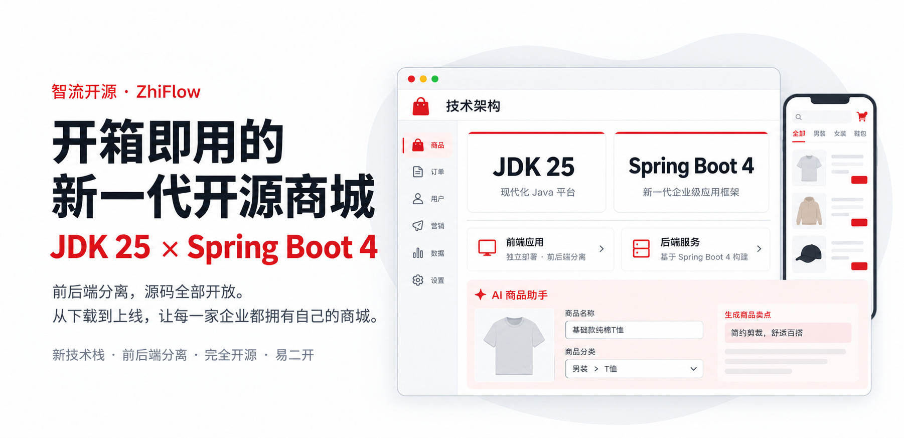

<p align="center">
  
</p>

# ZhiFlow（智流商城）：オープンソースの Java EC システム

[简体中文](README.md) | [繁體中文](README.zh-TW.md) | [English](README.en.md) | **日本語**

[](LICENSE)


ZhiFlow（智流商城）は、オープンソースの Java EC システムです。本リポジトリは ZhiFlow オープンソース版のバックエンドのメインリポジトリで、JDK 25、Spring Boot 4、Spring Security 7、PostgreSQL、Valkey、Vue 3、uni-app で作られています。単一店舗の EC サイト向けで、商品、バリエーション / SKU、カート、注文、WeChat Pay、Alipay、会員、権限、コンテンツ、レポートといった基本機能を備えています。学習、EC システムの選定、拡張開発のほか、自社ネットショップの構築にもそのまま使えます。

Java の EC システム、ネットショップのソースコード、EC サイト構築用のオープンソースを探しているなら、まずここから ZhiFlow の実装を見てみてください。複数店舗、マルチテナント SaaS、販促やアフィリエイト、越境 EC、オンライン診療などの医療向け機能、他のストアフロント、商用サポートが必要な場合は、下の「ライセンスとエディション」をご覧ください。

## プロジェクト概要

- **名称**：ZhiFlow（智流商城）。Java EC システム、ネットショップのソースコード
- **概要**：商用プラットフォーム「智流 · 開店引擎（ZhiFlow Store Engine）」のオープンソース版です。本番環境で長く運用してきた EC システムのコードがもとになっており、オープンソース化のために書いたデモではありません
- **事業形態**：単一店舗の EC サイト。管理画面と H5 ストアフロントを含みます
- **技術**：バックエンドは JDK 25 + Spring Boot 4.1.1 + Spring Security 7.1.1、フロントエンドは Vue 3 + uni-app。依存関係の正確なバージョンはバックエンドの `pom.xml` とフロントエンドの `package.json` を参照してください
- **デプロイ形態**：モジュラーモノリス。バックエンドは 1 つの jar で、必須のミドルウェアは PostgreSQL と Valkey（または Redis）のみ
- **オープンソースライセンス**：AGPL-3.0。学習、評価、ライセンスに沿った利用に
- **商用ライセンス**：ソース非公開での商用利用、プライベートデプロイ、商用サポート、各エディション。「ライセンスとエディション」を参照
- **商用エディション**：スタンダード版、越境版、医療版。機能とサービス内容は商用契約に従います
- **関連リンク**：ソースコードのリポジトリは「関連資料」を参照

## 特長

- JDK 25 + Spring Boot 4 + Vue 3、フロントエンドとバックエンドを分離
- モジュラーモノリス。jar 1 つでデプロイでき、サービスレジストリも設定サーバーも不要
- Spring Security 7 による認証・認可。OAuth2 Authorization Server を内蔵
- PostgreSQL データベース、Valkey / Redis キャッシュ、Redisson 分散ロック
- WeChat Pay と Alipay の本番チャネルに接続。モック決済ではありません
- 決済と注文それぞれに状態遷移の仕組み。コールバック後に決済チャネルへ結果を照会し、食い違いは照合キューに記録
- モジュール間は API 契約経由のみ。境界をまたぐ依存はテスト時に ArchUnit が検出
- AGPL-3.0 で公開。商用ライセンスとエディションは「ライセンスとエディション」を参照

## 技術バージョンについて

ZhiFlow オープンソース版は JDK 25 と Spring Boot 4.1 で構築しています。Spring Security 7、Tomcat 11、PostgreSQL 18 もいずれも現行の主要バージョンで、新規プロジェクトの検討や長期運用に向いています。古いフレームワークのまま止まっている EC システムは、あとからフレームワーク移行、依存関係の調整、セキュリティ対応に多くのコストがかかりがちです。

## 機能一覧

### H5 ストアフロント（購入者向け）

| モジュール | 機能 |
| --- | --- |
| アカウント | ID・パスワードログイン、SMS 認証コードログイン（任意、SMS サービスの設定が必要）、WeChat ログイン、会員登録、プロフィール、配送先住所 |
| 商品 | トップページ、カテゴリ、商品詳細、バリエーション選択、商品検索、人気キーワード |
| 購入 | カート、注文確認、支払い画面（WeChat Pay、Alipay）、支払い結果 |
| 注文 | 注文一覧、注文詳細、未払い注文のキャンセル、受け取り確認 |

### 管理画面

| モジュール | 機能 |
| --- | --- |
| 商品管理 | 商品登録、バリエーション / SKU、カテゴリ、ブランド、在庫、素材ライブラリ |
| 注文管理 | 注文検索、注文詳細、発送 |
| 会員管理 | 会員一覧、会員詳細 |
| コンテンツ管理 | トップページのバナー、人気キーワード |
| レポート | 注文・売上の基本レポート |
| 権限管理 | 管理者、ロール、メニュー、組織、辞書 |
| システム設定 | ストア設定、システムパラメータ、決済設定 |

### オープンソース版に含まれない機能

以下は商用エディションで提供しています。

- 返品・返金、クーポン、ポイント、商品レビュー、送料テンプレート、配送追跡、ページビルダー、残高払い、お気に入り、閲覧履歴
- タイムセール、共同購入、値下げキャンペーン、アフィリエイト販売、有料会員、チャットサポート、ライブコマース
- 複数店舗、マルチテナント SaaS、決済の分配と精算、請求書発行
- 多言語対応、WeChat ミニプログラム、スマホアプリ、PC 版ストア
- 越境 EC：多通貨、越境決済と精算、越境の税金・関税
- 医療：オンライン診療、ビデオ診療、診療中のリアルタイム字幕と翻訳、オンライン処方

## ドキュメントとクイックスタート

デプロイ、本番公開、アップグレード、ローカル開発の詳しい手順は、バックエンドリポジトリの README（中国語）を参照してください：https://github.com/zhiliumall/zhiflow#readme

### Docker Compose でまとめて起動する

Docker 24 以上と Docker Compose v2.24 以上が必要です。3 つのリポジトリを同じディレクトリに並べてクローンします。

```bash
mkdir zhiflow-mall && cd zhiflow-mall
git clone https://github.com/zhiliumall/zhiflow.git
git clone https://github.com/zhiliumall/zhiflow-admin.git
git clone https://github.com/zhiliumall/zhiflow-uniapp.git
cd zhiflow
./scripts/init-env.sh
docker compose up -d --build
```

初回起動時にテーブルが自動で作成されます。管理者 `admin` の初期パスワードはランダムに生成され、`docker compose logs app | grep -A4 首次启动` で確認できます。初回ログイン時にパスワードの変更を求められます。
`http://localhost/` が H5 ストアフロント、`http://localhost/admin/` が管理画面です。

本番公開の前に、バックエンド README に沿ってドメインと HTTPS を設定し、ご自身の加盟店アカウントでサンドボックス上の決済とコールバックを一通りテストしてください。

## ライセンスとエディション

本リポジトリのオープンソース版は AGPL-3.0 で公開しています。ライセンスの条件に従って、学習、研究、拡張開発、セルフホストができます。改変したプログラムをネットワーク経由でサービスとして提供する場合は、その利用者に対応するソースコードを提供する必要があります。

ソース非公開での商用利用、プライベートデプロイ、商用サポート、そして複数店舗、マルチテナント SaaS、越境、医療の各エディションは商用ライセンスの対象です。詳しくは下記のお問い合わせ先までご連絡ください。

- **オープンソース版**：単一店舗の EC サイト。学習、評価、AGPL-3.0 に沿った利用向け
- **スタンダード版**：複数店舗、マルチテナント SaaS、販促、アフィリエイト販売、カスタマーサポート、ミニプログラムやアプリなどのストアフロント
- **越境版**：スタンダード版の機能に加え、多通貨、多言語、越境決済と精算、越境の税金・関税
- **医療版**：スタンダード版の機能に加え、オンライン診療、ビデオ診療、リアルタイム字幕と翻訳、オンライン処方

お問い合わせ：WeChat +86 17789617999（電話番号で検索して追加）、または下の WeCom（企業微信）QR コードをスキャン


## オープンソース版と商用版

| | オープンソース版 | 商用版 · 智流開店引擎 |
| --- | --- | --- |
| 学習、評価、拡張開発 | 可能 | 可能 |
| ライセンス | AGPL-3.0 | 商用ライセンス |
| ソース非公開での商用利用 | 商用ライセンスが必要 | 商用ライセンスの範囲で可能 |
| デプロイ | セルフホスト（AGPL-3.0 に従う） | プライベートデプロイの提供が可能 |
| 事業形態 | 単一店舗の EC サイト | マルチテナント SaaS。1 つのコードベースで複数店舗・複数業種を運営 |
| 注文・決済 | 通常商品の注文、WeChat Pay と Alipay、発送、受け取り | 6 種類の注文タイプ、残高払いや越境決済を含む複数の決済チャネル |
| アフターサービス | 含まない | 返金、返品・返金 |
| 販促 | 含まない | クーポン、ポイント、共同購入・タイムセール・ライブコマースなど 10 種類のキャンペーン |
| 運営 | バナー、人気キーワード | ページビルダー、レビュー、お気に入り、閲覧履歴、送料テンプレート、配送追跡 |
| アフィリエイト販売 | 含まない | 3 種類の分配モデル |
| カスタマーサポート | 含まない | チャットサポート、AI カスタマーサポート、AI ショッピングアシスタント |
| 検索・レコメンド | 商品検索 | スマート検索、パーソナライズドレコメンド |
| 決済・会計 | 含まない | 決済の分配、精算、請求書発行 |
| 越境 | 含まない | 越境版：多通貨、多言語、越境決済と精算、越境の税金・関税 |
| 医療 | 含まない | 医療版：オンライン診療（チャット）、ビデオ診療、リアルタイム字幕と翻訳、オンライン処方 |
| ストアフロント | H5 | WeChat ミニプログラム、WeChat H5、H5、スマホアプリ、PC |
| サポート | 主にコミュニティ | 商用サポート |

商用版の機能とサービス内容は、商用契約に従います。

## よくある質問

**ZhiFlow とは何ですか？**

オープンソースの Java EC システムです。バックエンドは Spring Boot 4、管理画面は Vue 3、H5 ストアフロントは uni-app で作られています。本リポジトリはオープンソース版のメインリポジトリで、単一店舗の EC サイトとして、商品登録から購入者の受け取り確認までの流れがすべて使えます。

**ZhiFlow オープンソース版は無料で使えますか？**

AGPL-3.0 を守れば無料で使えます。いちばん重要な条件は、改変したコードをネットワーク経由でサービスとして提供する場合、そのソースコードを利用者に公開することです。AGPL-3.0 が合わないプロジェクトは、お問い合わせ先まで商用ライセンスについてご相談ください。

**実際のネットショップ運営に使えますか？**

使えます。オープンソース版は WeChat Pay と Alipay に対応しており、WeChat 内で H5 を開けば注文できます。実際に決済を受け付ける前に、ご自身の加盟店アカウントでサンドボックス上の決済とコールバックを一通りテストしてください。

**支払い済みの注文はどう返金しますか？**

オープンソース版には現在、返金機能がありません。返金は WeChat Pay または Alipay の加盟店管理画面から行ってください。v1.1 では、未発送注文の全額返金（元の決済方法へ）と基本的な送料設定（固定送料、一定金額以上で送料無料）を提供する予定です。返品・返金を含む本格的なアフターサービスは商用エディションで提供しています。

**オープンソース版にクーポンや返品・返金がないのはなぜですか？**

オープンソース版は注文から受け取りまでの基本の流れに絞り、コードを読みやすく、拡張しやすくしています。クーポン、ポイント、返品・返金は注文金額の計算や決済の返金と深く結びついていて、まとめて提供しないと成り立たないため、商用エディションに置いています。必要であればオープンソース版の上で自作するか、商用エディションをご検討ください。

**なぜマイクロサービスではないのですか？**

中小規模のチームがマイクロサービスを採用すると、労力の多くが運用に取られます。オープンソース版はすべての業務モジュールを 1 つの jar にまとめ、モジュール間は API 契約経由で呼び出します。境界は保ったまま、デプロイも障害調査もずっとシンプルになります。

**ZhiFlow は Spring Boot 4 と Vue 3 に対応していますか？**

対応しています。バックエンドは JDK 25 と Spring Boot 4.1、フロントエンドは Vue 3 と uni-app で作られています。依存関係の正確なバージョンはバックエンドの `pom.xml` とフロントエンドの `package.json` を参照してください。

**WeChat ミニプログラムやスマホアプリには対応していますか？**

オープンソース版は H5 ストアフロントのみです。WeChat ミニプログラム、スマホアプリ、PC 版ストアは商用エディションで提供しています。

**商用版にはどんなエディションがありますか？**

3 つあり、いずれもプライベートデプロイに対応しています。

- スタンダード版：複数店舗、マルチテナント SaaS、販促、アフィリエイト販売、カスタマーサポート、ミニプログラムやアプリなどのストアフロント
- 越境版：スタンダード版の機能に加え、多通貨、多言語、越境決済と精算、越境の税金・関税。海外販売向け
- 医療版：スタンダード版の機能に加え、オンライン診療、ビデオ診療、リアルタイム字幕と翻訳、オンライン処方。オンライン病院や医薬品 EC 向け

**商用版のソースコードはどのように提供されますか？**

提供方法、ライセンス期間、保守サービスは、商用契約に従います。

**ZhiFlow はどんな EC サイトに向いていますか？**

本オープンソースリポジトリは、自社運営の単一店舗 EC サイト、Java の EC システムの学習、ソースコードの評価、拡張開発、プロトタイプ構築に向いています。複数店舗のモール、マルチテナント SaaS、越境 EC、オンライン医療、プライベートデプロイが必要な場合は、スタンダード版、越境版、医療版をご覧ください。

## 関連資料

- GitHub リポジトリ：https://github.com/zhiliumall/zhiflow
- Gitee リポジトリ：https://gitee.com/sssrer/zhiliumall

## 関連リポジトリ

| リポジトリ | 説明 |
| --- | --- |
| zhiflow | ZhiFlow オープンソース版のバックエンド。メインリポジトリ、単一店舗の EC サイト |
| zhiflow-admin | Vue 3 の管理画面 |
| zhiflow-uniapp | uni-app の H5 ストアフロント |

リリースごとに 3 つのリポジトリの対応バージョンを Release に記載します。3 つとも同じバージョン番号のものを組み合わせて使ってください。

## バックエンドのモジュール

| モジュール | 説明 |
| --- | --- |
| zhiflow-boot | 起動モジュール。各業務モジュールを 1 つの実行可能 jar にまとめる |
| zhiflow-auth | ログイン、トークンの発行と更新、画像 CAPTCHA |
| zhiflow-upms | 管理者、ロール、メニュー、組織、辞書、システムパラメータ |
| zhiflow-mall-api | 購入者向け API：商品、検索、カート、注文、会員情報、配送先住所 |
| zhiflow-mall-admin | 管理画面向け API：商品、注文、発送、会員、バナー、人気キーワード、レポート、ストア設定 |
| zhiflow-pay | 決済、WeChat Pay、Alipay、決済コールバックと能動的な状態照会 |
| zhiflow-weixin | WeChat Web ログイン。WeChat JSAPI 決済に必要な openid を提供 |
| zhiflow-api | モジュール間の API 契約とデータ転送オブジェクト |
| zhiflow-common | 共通コード：レスポンスとエラー処理、セキュリティコンテキスト、キャッシュ、データアクセス |

## 技術スタック

| 技術 | バージョン | 用途 |
| --- | --- | --- |
| JDK | 25 | 実行環境 |
| Spring Boot | 4.1.1 | バックエンドフレームワーク |
| Spring Security | 7.1.1 | 認証・認可。OAuth2 Authorization Server を内蔵 |
| Tomcat | 11.0.24 | Web コンテナ |
| PostgreSQL | 18 | データベース |
| Valkey | 9.0 | キャッシュ。Redis 互換で、Redis もそのまま使えます |
| Redisson | 4.7.0 | キャッシュクライアント、分散ロック |
| MeiliSearch | 1.34.0 | 商品検索。任意。使わない場合はデータベース検索 |
| MinIO | 設定に従う | ファイルストレージ。任意。使わない場合はローカルディスク |
| ArchUnit | 1.4.1 | モジュール依存ルールのチェック |
| Vue | 3.5 | 管理画面と H5 ストアフロント |
| uni-app | package.json に従う | H5 ストアフロント |

## コード品質

コミットのたびに、GitHub Actions ですべての単体テストと ArchUnit のルールを実行しています。モジュールが API 契約を通さずに他のモジュールへ直接依存すると、ビルドが失敗します。

## コントリビューション

Issue を歓迎します。現在、外部からのコード提供（Pull Request）は受け付けていません。

## セキュリティ

脆弱性は公開の Issue に書かず、GitHub から非公開で報告してください：[Report a vulnerability](https://github.com/zhiliumall/zhiflow/security/advisories/new)。

## コミュニティとフィードバック

- 不具合の報告：GitHub Issues

## ライセンス

ZhiFlow は [AGPL-3.0](LICENSE) ライセンスのもとで公開しています。

## 謝辞

ZhiFlow は次のオープンソースプロジェクトを利用しています：Spring Boot、Spring Security、Apache Tomcat、PostgreSQL、Valkey、Redisson、MeiliSearch、MinIO、ArchUnit、uni-app、Vue。
